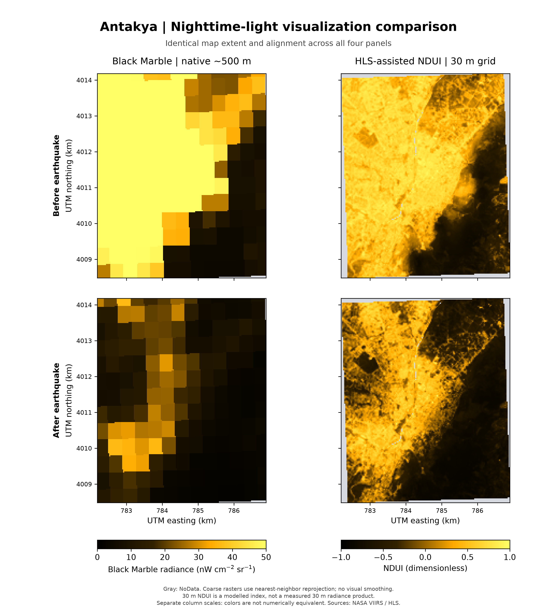
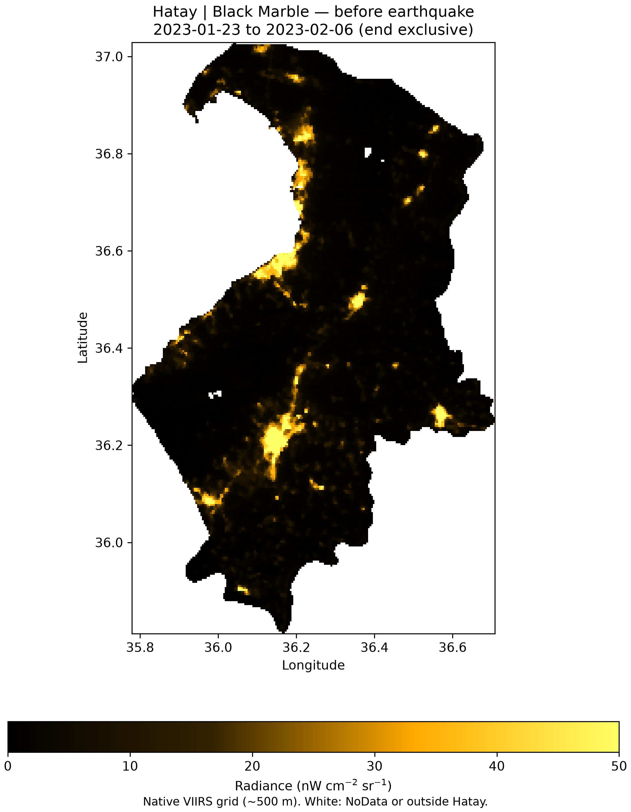

# Black Marble + HLS: nighttime-light change around Antakya

A Python remote-sensing workflow for exploring nighttime-light changes before and after the February 2023 Türkiye earthquakes. It combines NASA VIIRS Black Marble with a fixed Harmonized Landsat–Sentinel (HLS) optical base, exports GeoTIFFs, and creates geographically aligned comparison figures.



The left column shows Black Marble radiance on its native approximately 500 m grid. The right column shows a **modelled 30 m NDUI visualization** using daytime surface information. Each column uses one fixed color scale across dates; the two columns measure different quantities.

## What I built

- A Python port of an Earth Engine JavaScript workflow using the Earth Engine API.
- Quality-filtered composites of direct, non-gap-filled VIIRS observations.
- A shared HLS NDVI/NDWI base and normalization reference for before–after comparison.
- Native-grid coarse and 30 m NDUI GeoTIFF downloads, with configuration and provenance manifests.
- Raster reprojection, common-extent alignment, NoData handling, and PNG/PDF comparison plots.
- An additional province-wide Black Marble view of Hatay.

This project demonstrates Python, geospatial raster processing, Earth Engine, satellite quality flags, and reproducible visualization. **No deep-learning model is trained in this version.**

## Method

1. Select `DNB_BRDF_Corrected_NTL` from VNP46A2; do not substitute the gap-filled band.
2. Mask daytime, poor-quality, cloud-contaminated, snow and cirrus observations. The example accepts medium/high cloud-mask quality and confident/probably-clear classifications.
3. Mosaic VIIRS tiles by product date, then compute each period's median and distinct valid-observation-day count.
4. Calculate a single pre-event reference p99 to normalize both periods.
5. Merge HLS Landsat and Sentinel observations, using Landsat `B5` and Sentinel `B8A` as NIR. Calculate per-observation NDVI/NDWI, then take a shared pre-event median.
6. Interpolate normalized VIIRS to a fixed 30 m grid and calculate:

   `NDUI = (NTL_normalized − NDVI) / max(NTL_normalized + NDVI, 0.001)`

   NTL is clamped to [0, 1]; negative NDVI is clamped to zero. Mask NDWI > 0 and require valid VIIRS coverage in both periods for the NDUI comparison.
7. Export and plot. Coarse values remain on their native grid in the TIFFs. Plotting uses nearest-neighbor reprojection to align coarse rasters with the HD footprint, without visual smoothing.

There is no WELD temporal gap filling or OSM road enhancement. Coarse exports retain each period's own coverage; NDUI exports use shared coverage plus the HLS water/validity mask.

## Example settings

| Setting | Value |
| --- | --- |
| Before | 23 January–5 February 2023 |
| After | 7–20 February 2023 |
| Shared optical/reference period | 1 January 2022–5 February 2023 |
| Antakya export box (west, south, east, north) | `[36.14, 36.18, 36.19, 36.23]` |
| NDUI grid | EPSG:32636, 30 m |
| Minimum valid VIIRS days | 1 |

All JSON end dates are **exclusive**. These are period composites, not single-night maps. Post-event recovery within a period can affect its median.

`mask_shadow` is an explicit configuration option. It defaults to `false` to match the effective final JavaScript used for the example, where the shadow test had been commented out. Setting it to `true` applies an additional shadow mask and changes coverage. Relaxing QA increases coverage but can also increase contamination.

## Run

Use Python 3.12. A registered Earth Engine project and Google authentication are required to generate new satellite products. Local plotting of existing TIFFs does not need Earth Engine authentication.

```bash
python -m venv .venv
source .venv/bin/activate
python -m pip install --only-binary=:all: -r requirements.txt
cp python_workflow/config.example.json python_workflow/config.local.json
```

Set `project` in `config.local.json` to your Earth Engine-enabled Google Cloud project. Then authenticate and check the source/date/grid diagnostics:

```bash
python python_workflow/earth_engine_pipeline.py --authenticate
```

Download four small Antakya GeoTIFFs directly into the repository's `outputs/` directory:

```bash
python python_workflow/earth_engine_pipeline.py --download
```

Existing local TIFFs are protected unless `--overwrite` is supplied. For larger areas, use `--export` to submit Google Drive tasks instead. Direct download is limited by Earth Engine request size and dimensions; it is not intended for a country-wide 30 m raster.

Create aligned PNG and PDF figures:

```bash
python python_workflow/plot_comparison.py
```

The plotter reads the four TIFFs from `outputs/` and writes `antakya_comparison.png`, `.pdf`, and `alignment.json` there. Figure filenames are overwritten on rerun. Older `Hatay_BlackMarble_coarse_*` filenames are also supported.

### Hatay boundary and exact reproduction

The published example used an owner-provided **Hatay province boundary asset** for the optical/reference calculation region. The boundary is not distributed in this repository, and no private asset identifier or credentials are included.

The public configuration uses `roi_asset: null`, making the Antakya export box the calculation region. This lets the core workflow run without that asset, but its normalization p99 and NDUI values can differ from the Hatay-calibrated figure. To reproduce that calibration, provide an accessible matching Hatay boundary via `roi_asset` and `roi_filter`.

The optional Hatay scripts require such an asset:

```bash
python python_workflow/plot_hatay_before.py
python python_workflow/plot_hatay_comparison.py
```



## Validation performed

The Python workflow was authenticated, executed against Earth Engine, and used to download four GeoTIFFs locally. For the two Antakya NDUI products, comparison with the final GEE exports found:

- Identical CRS, pixel grid and dimensions: **157 × 190 pixels**.
- Identical valid-data masks after treating NaN and NoData consistently.
- **28,043 valid pixels per image**, with **zero maximum absolute difference** in their stored float32 values.

See [validation metadata](examples/validation.json). This checks implementation agreement for these two rasters; it does not establish independent accuracy, and numerical parity of the separately generated coarse exports was not tested.

## Interpretation

The 30 m image is a **dimensionless NDUI estimate**, not a measured 30 m nighttime-radiance product or an official NASA Black Marble HD release. Fine spatial structure comes from daytime reflectance. More detailed appearance does not establish building-level illumination, electricity access, or outage status. Missing observations are retained as NoData, not interpreted as darkness. The fixed optical base intentionally excludes post-earthquake surface changes.

The coarse plot clips the displayed radiance scale at 50; values above that threshold share the brightest color. NDUI uses a separate −1 to 1 scale.

## Repository contents

```text
python_workflow/
  earth_engine_pipeline.py   # Earth Engine computation and downloads
  plot_comparison.py         # Four-panel Antakya PNG/PDF
  plot_hatay_before.py       # Province-wide pre-event map
  plot_hatay_comparison.py   # Province-wide before/after map
  config.example.json       # Portable settings template
examples/                   # Published figures and validation record
requirements.txt
```

Local configurations, virtual environments, credentials, generated outputs and TIFFs are excluded from version control.

## Data and references

- [NASA VNP46A2 / VIIRS Black Marble and quality-bit definitions](https://developers.google.com/earth-engine/datasets/catalog/NASA_VIIRS_002_VNP46A2)
- [HLS Landsat L30](https://developers.google.com/earth-engine/datasets/catalog/NASA_HLS_HLSL30_v002) and [HLS Sentinel S30](https://developers.google.com/earth-engine/datasets/catalog/NASA_HLS_HLSS30_v002)
- [NASA Black Marble HD product description](https://science.data.nasa.gov/disasters/data-gallery/black-marble-hd)
- [Román et al. (2019), Satellite-based assessment of electricity restoration efforts in Puerto Rico after Hurricane Maria](https://doi.org/10.1371/journal.pone.0218883)
- [NASA Earth Observatory: Dark Nights in Antakya](https://science.nasa.gov/earth/earth-observatory/dark-nights-in-antakya-151029/)

Credit the NASA Black Marble and HLS science teams when reusing the results. The MIT license covers this repository's code; upstream datasets retain their own terms.
